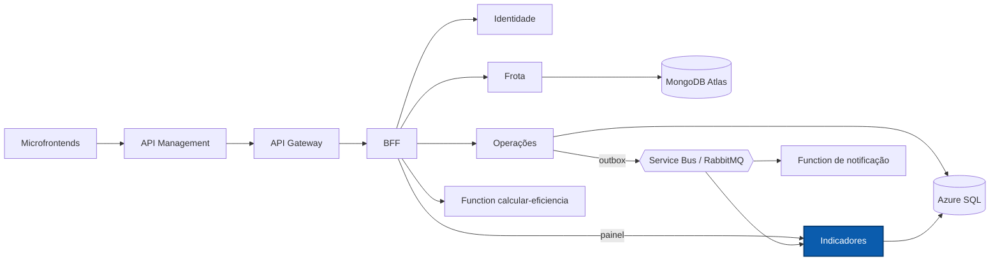

# NexFleet Indicadores

Microsserviço de indicadores do NexFleet: consome os eventos operacionais da frota, mantém projeções idempotentes e fornece os números do painel de custos.

[](https://github.com/mateusblm/nexfleet-indicadores/actions/workflows/ci.yml)
[](https://hub.docker.com/r/mateusblm/nexfleet-indicadores)


---

## Visão geral

O NexFleet é uma plataforma de gestão de frotas empresariais: veículos, motoristas, vínculos, abastecimentos, manutenções, painel de custos e uma visão consolidada de eficiência.

**Indicadores** é o lado de leitura orientado a eventos. Consome `AbastecimentoRegistrado` v1 e `ManutencaoRegistrada` v1 publicados pela outbox de Operações, do **Azure Service Bus** (nuvem) ou do **RabbitMQ** (local), e grava projeções no **Azure SQL** (schema `indicadores`, usuário de banco exclusivo, migrações Flyway). O BFF consulta o painel daqui e o combina com a situação da frota vinda de Frota.



## Funcionalidades

- Consumo de `AbastecimentoRegistrado` v1 e `ManutencaoRegistrada` v1, com transporte selecionável: Service Bus (assinatura `indicadores-v1` do tópico `nexfleet-eventos-v1`) ou RabbitMQ.
- **Projeções idempotentes**: um evento entregue mais de uma vez tem efeito uma única vez.
- No RabbitMQ: até 3 tentativas com recuo exponencial (500 ms a 2 s) e, depois disso, envio para a fila de mensagens mortas (DLQ) de cada projeção.
- Painel com gasto em abastecimentos, gasto em manutenções, gasto total, quantidade de registros e as 5 próximas manutenções programadas.
- Readiness ligado ao banco: sem SQL disponível, responde `503`.

## Arquitetura

**Clean Architecture + Vertical Slice.** Cada caso de uso é uma fatia em `br.com.nexfleet.indicadores`. As regras puras dos eventos projetados ficam em `domain` (sem Spring, JDBC nem Jackson); `application` orquestra os casos de uso e define as portas; `infrastructure` e `api` são adaptadores.

| Fatia | Camadas | Responsabilidade |
|---|---|---|
| `projetarabastecimento` | `application`, `domain`, `infrastructure` | Projetar registro, atualização e exclusão de abastecimento; consumidor e topologia RabbitMQ (filas, DLX e DLQ) |
| `projetarmanutencao` | `application`, `domain`, `infrastructure` | Projetar registro, atualização e exclusão de manutenção |
| `consultardashboard` | `api`, `application`, `infrastructure` | Painel de gastos e próximas manutenções |
| `consultarservico` | `api`, `application`, `infrastructure` | Informações do serviço e verificação do banco |

No `domain` ficam as validações dos eventos, a versão padrão de eventos sem `versao` e a data da exclusão. A regra de só aplicar versão maior e de a marca de exclusão vencer eventos atrasados é executada atomicamente no `MERGE` do adaptador SQL, por isso fica em `infrastructure`. `consultardashboard` e `consultarservico` só leem e compõem dados e não têm `domain`.

Pacotes técnicos: `servicebus/infrastructure` (consumidor do Service Bus), `infrastructure` (inserção idempotente), `config` e `observability` (correlação).

Regras verificadas pelo ArchUnit (`ArchitectureTest`):

- persistência (JDBC, `java.sql`, JPA) só em `infrastructure`;
- todo código fica em `api`, `application`, `domain`, `infrastructure` ou nos pacotes técnicos conhecidos;
- `domain` não depende de `application`, `infrastructure`, `api`, `config`, Spring, Jakarta, JDBC nem Jackson;
- `application` não depende de framework nem de adaptadores;
- `api` não acessa a persistência diretamente;
- nenhuma classe importa código interno de outros serviços.

## API

| Método | Rota interna | Exposta pelo BFF como | Descrição |
|---|---|---|---|
| `GET` | `/api/v1/indicadores/dashboard` | `GET /api/v1/dashboard` (composto com Frota) | Gastos, quantidades e próximas manutenções |
| `GET` | `/api/v1/indicadores/info` | — | Informações do serviço |

O OpenAPI do serviço é publicado em `/v3/api-docs` e reunido na Swagger UI do Gateway: **[Swagger UI em produção](https://apim-nexfleet-homolog-ukzjodf42myfe.azure-api.net/swagger-ui.html)** (seletor "Indicadores").

### Eventos consumidos

| Evento | Service Bus | RabbitMQ (fila → DLQ) |
|---|---|---|
| `AbastecimentoRegistrado` v1 | `nexfleet-eventos-v1` / `indicadores-v1` | `nexfleet.indicadores.projecao-abastecimentos.v1.com-dlq` → `nexfleet.indicadores.projecao-abastecimentos.v1.dlq` |
| `ManutencaoRegistrada` v1 | `nexfleet-eventos-v1` / `indicadores-v1` | `nexfleet.indicadores.projecao-manutencoes.v1.com-dlq` → `nexfleet.indicadores.projecao-manutencoes.v1.dlq` |

Contrato completo na [página AsyncAPI](https://white-mushroom-0cadda010.3.azurestaticapps.net/docs/eventos/).

## Stack

| Camada | Tecnologia | Versão |
|---|---|---|
| Linguagem | Java | 21 |
| Framework | Spring Boot (Web MVC, Security, OAuth2 Resource Server, JDBC, AMQP, Actuator) | 4.1.1 |
| Banco de dados | Azure SQL / SQL Server (`mssql-jdbc`) | — |
| Migrações | Flyway (`flyway-sqlserver`) | gerenciada pelo Spring Boot |
| Mensageria | Azure Service Bus (`azure-messaging-servicebus`, `azure-identity`) / RabbitMQ | Azure SDK BOM 1.3.9 |
| Documentação | springdoc-openapi (`/v3/api-docs`) | 3.2.0 |
| Observabilidade | Micrometer + Prometheus | gerenciada pelo Spring Boot |
| Testes | JUnit 5, Testcontainers (SQL Server), ArchUnit | 5 / — / 1.4.1 |
| Build | Maven Wrapper | 3.9.16 |
| Contêiner | `eclipse-temurin:21-jre-jammy` | 21 |
| CI/CD | GitHub Actions → Docker Hub | — |

## Primeiros passos

### Pré-requisitos

- JDK 21 (o Maven vem pelo wrapper `./mvnw`)
- Docker, para os testes de integração (Testcontainers) e para executar a imagem

### Testes

```bash
./mvnw -B -ntp verify
```

### Executar com Docker

O serviço precisa de um SQL Server com o schema `indicadores` e um usuário de banco já criados, de um RabbitMQ (ou Service Bus) e da Identidade.

```bash
docker run --rm -p 8084:8080 \
  -e SPRING_PROFILES_ACTIVE=jwt-rsa \
  -e DB_URL="jdbc:sqlserver://<host>:1433;databaseName=<banco>;encrypt=true" \
  -e DB_USER=<usuário> \
  -e DB_PASSWORD=<senha> \
  -e IDENTIDADE_URL=http://<host-da-identidade>:8080 \
  -e RABBITMQ_HOST=<host-do-rabbitmq> \
  -e RABBITMQ_USER=<usuário> \
  -e RABBITMQ_PASSWORD=<senha> \
  mateusblm/nexfleet-indicadores:v1.0.0
```

Para gerar a imagem a partir do código: `docker build -t mateusblm/nexfleet-indicadores:local .`

### Ambiente completo

O produto inteiro (todos os serviços, SQL Server, MongoDB e RabbitMQ) sobe pelo repositório [nexfleet](https://github.com/mateusblm/nexfleet):

```bash
git clone https://github.com/mateusblm/nexfleet.git && cd nexfleet
scripts/clonar-tudo.sh                                        # clona os demais repositórios ao lado
scripts/iniciar-local.sh                                      # gera o .env e a chave RSA local
docker compose -f compose.yaml -f compose.build.yaml up -d --build
scripts/seed-demo.sh                                          # dados de demonstração
```

## Configuração

| Variável | Descrição | Padrão |
|---|---|---|
| `PORT` | Porta HTTP | `8080` |
| `SPRING_PROFILES_ACTIVE` | `jwt-rsa` valida o token pela JWKS da Identidade | — |
| `DB_URL` | URL JDBC do SQL Server / Azure SQL | obrigatória |
| `DB_USER` | Usuário de banco do serviço | obrigatória |
| `DB_PASSWORD` | Senha do usuário de banco; segredo | obrigatória |
| `IDENTIDADE_URL` | URL da Identidade (JWKS) | `http://localhost:8081` |
| `MESSAGING_PROVIDER` | Transporte de eventos: `rabbit` ou `servicebus` | `rabbit` |
| `RABBITMQ_HOST` | Host do RabbitMQ | `localhost` |
| `RABBITMQ_PORT` | Porta AMQP | `5672` |
| `RABBITMQ_USER` | Usuário do RabbitMQ | `nexfleet` |
| `RABBITMQ_PASSWORD` | Senha do RabbitMQ; segredo | — |
| `SERVICEBUS_FULLY_QUALIFIED_NAMESPACE` | Namespace do Service Bus (autenticação por identidade gerenciada) | vazio |
| `SERVICEBUS_TOPIC` | Tópico do Service Bus | `nexfleet-eventos-v1` |
| `SERVICEBUS_INDICADORES_SUBSCRIPTION` | Assinatura do Service Bus | `indicadores-v1` |

## Ambiente em nuvem

| Recurso | Endereço |
|---|---|
| Aplicação | https://white-mushroom-0cadda010.3.azurestaticapps.net |
| API (Azure API Management) | https://apim-nexfleet-homolog-ukzjodf42myfe.azure-api.net |
| Swagger UI | https://apim-nexfleet-homolog-ukzjodf42myfe.azure-api.net/swagger-ui.html |
| AsyncAPI dos eventos | https://white-mushroom-0cadda010.3.azurestaticapps.net/docs/eventos/ |
| Imagem Docker | https://hub.docker.com/r/mateusblm/nexfleet-indicadores |

Indicadores roda em Azure Container Apps, sem URL pública própria, com dados no Azure SQL e eventos do Azure Service Bus.

> Os serviços escalam a zero quando ociosos. A primeira requisição após um período de inatividade pode levar de 1 a 2 minutos.

## Testes

| Tipo | Exemplos | O que cobre |
|---|---|---|
| Unitários | `ProjetarAbastecimentoTest`, `ProjetarManutencaoTest`, `ConsultarDashboardTest`, `InsercaoIdempotenteTest` | Projeções, idempotência e cálculo do painel |
| Mensageria | `ServiceBusEventoListenerTest`, `RabbitTopologyConfigTest` | Consumo do Service Bus e topologia de filas, DLX e DLQ |
| Integração (Testcontainers, SQL Server) | `ProjecaoAbastecimentoIdempotenteIT`, `ProjecaoManutencaoIdempotenteIT`, `DashboardSqlServerIT` | Projeções e painel em SQL Server real |
| Arquitetura (ArchUnit) | `ArchitectureTest` | Camadas, persistência só em `infrastructure`, isolamento entre serviços |

```bash
./mvnw -B -ntp verify     # testes de integração exigem Docker
```

O CI (`.github/workflows/ci.yml`) executa `verify` a cada push e pull request; em tags `v*`, publica `mateusblm/nexfleet-indicadores:<tag>` e `:latest` no Docker Hub.

## Equipe

- Vinícius dos Reis Góes
- Mateus Burlamaqui
- Lucas Roussenq
- Erik Carvalho
